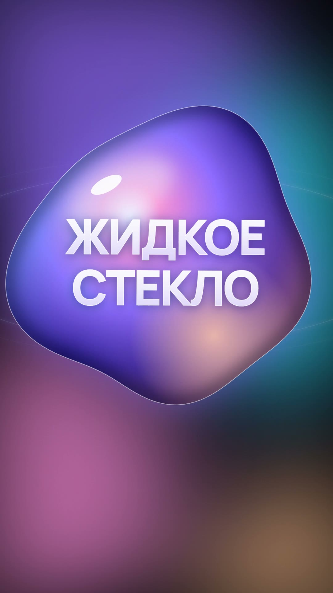
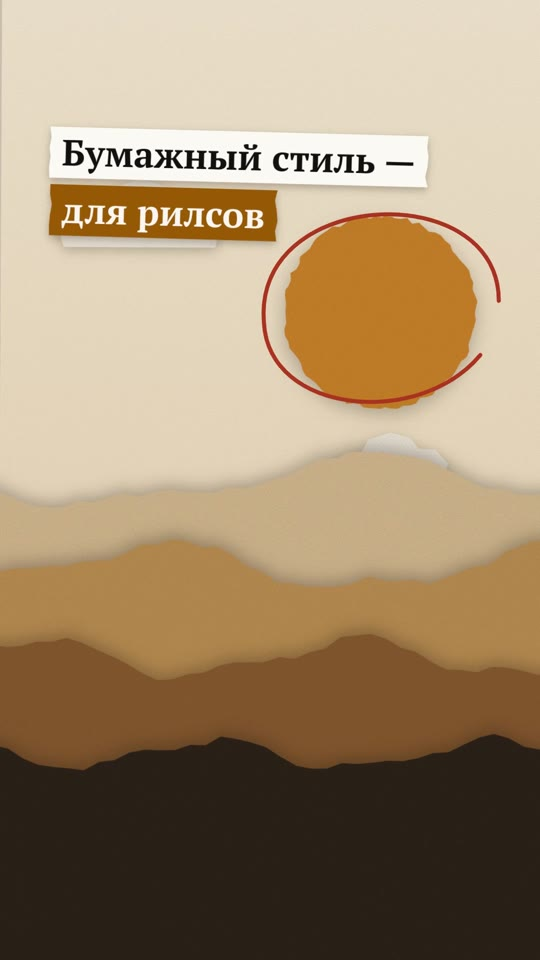
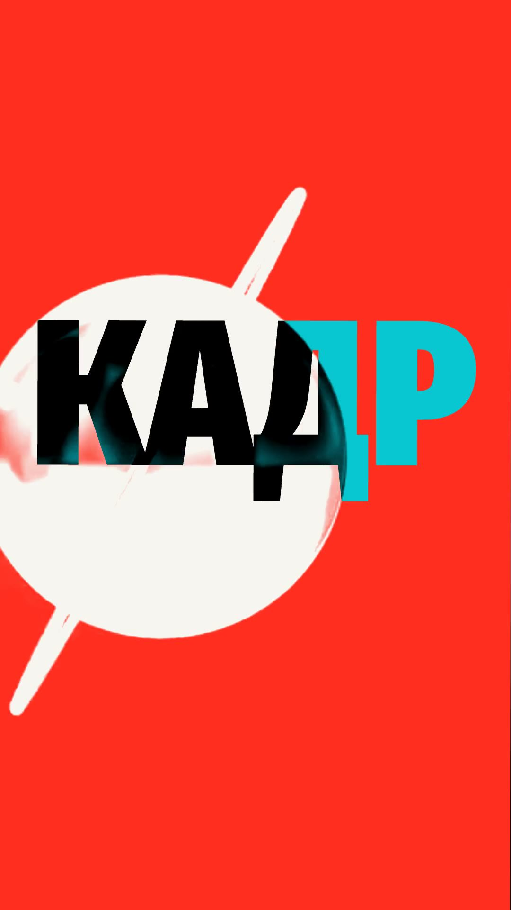
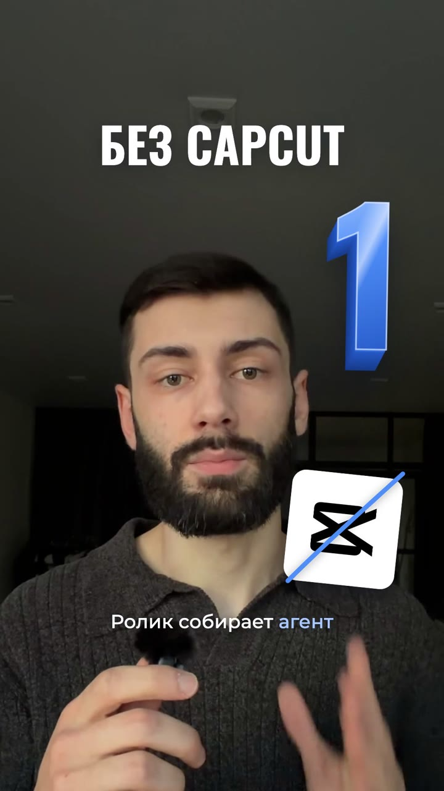

# Стили фабрики роликов

Чтобы поставить стиль, напишите агенту фабрики его название: «включи стиль Слои».
Он скачается и включится сам.

## Жидкое стекло

Ролик за толстым стеклом: жидкий свет переливается сзади, слова проступают из тумана, факты падают каплями и сливаются, кадр живёт в стеклянной капсуле.

## Бумажная печать

Коллаж в движении: вырезки на скотче, наклейки, полоски-подписи, рука с карандашом, переходы бумагой.

## Удар

Кинетическая типографика: слово во всю ширину кадра врезается на каждое ударное слово, поле меняет цвет рывком, картинка в два цвета, переходы-удары.

## Слои

Говорящий эксперт в слоях: заголовок и объёмная цифра за головой, вставки и рукописные подписи с баунсом, крупный айфон с записью экрана, зумы на склейках.
